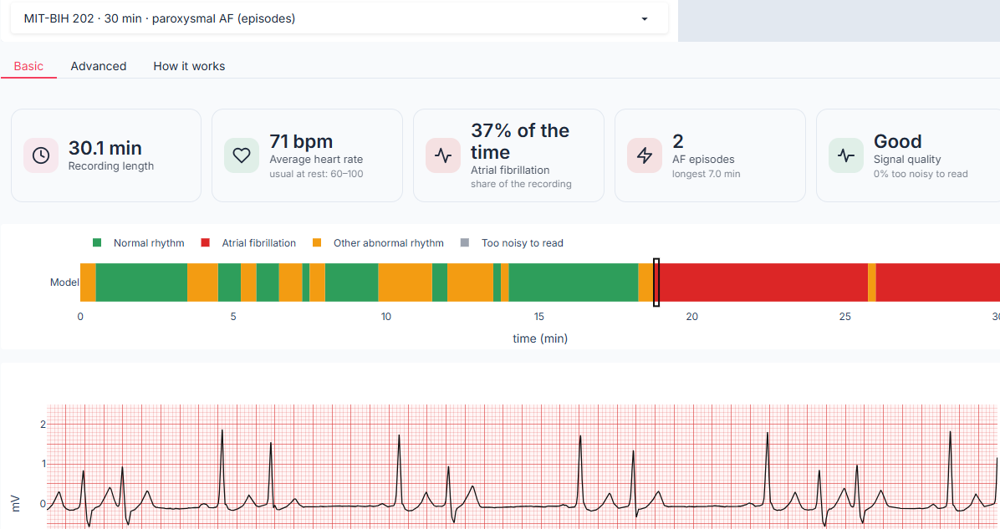
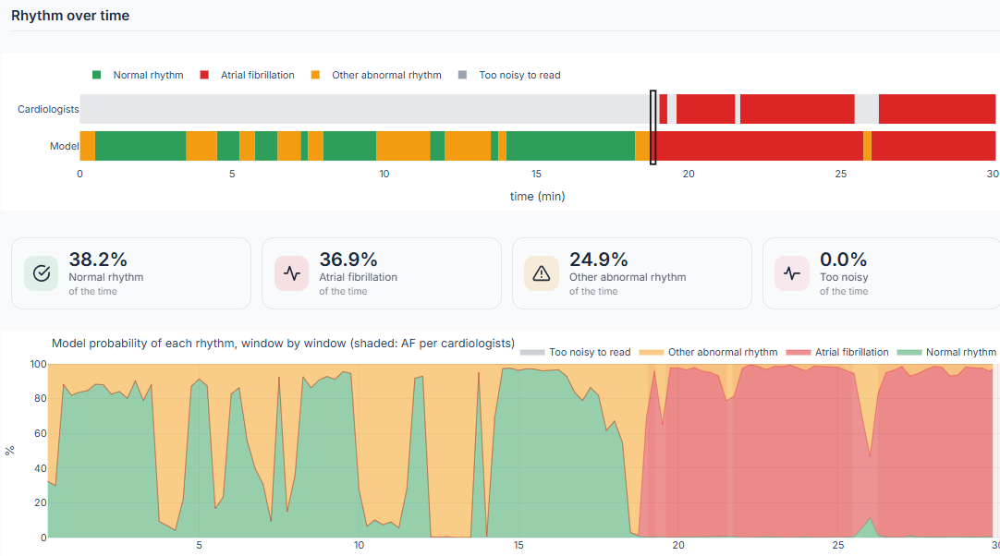
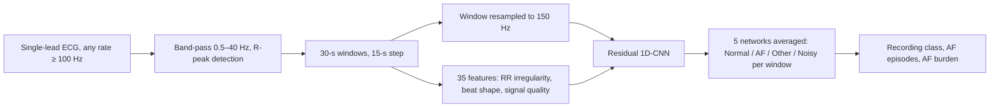
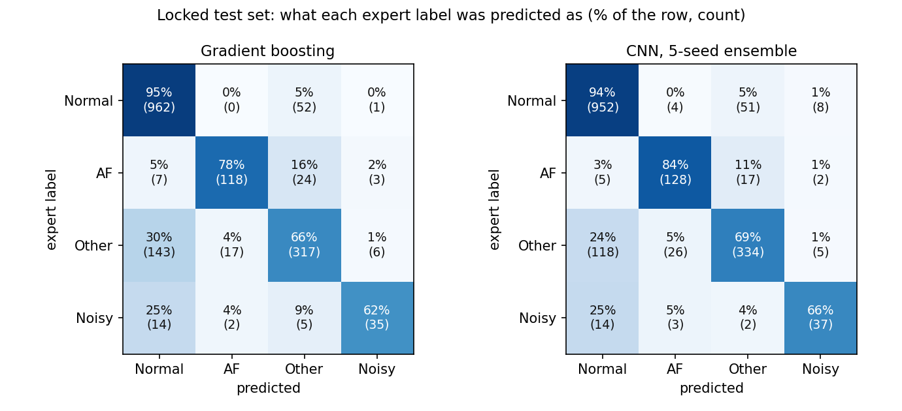
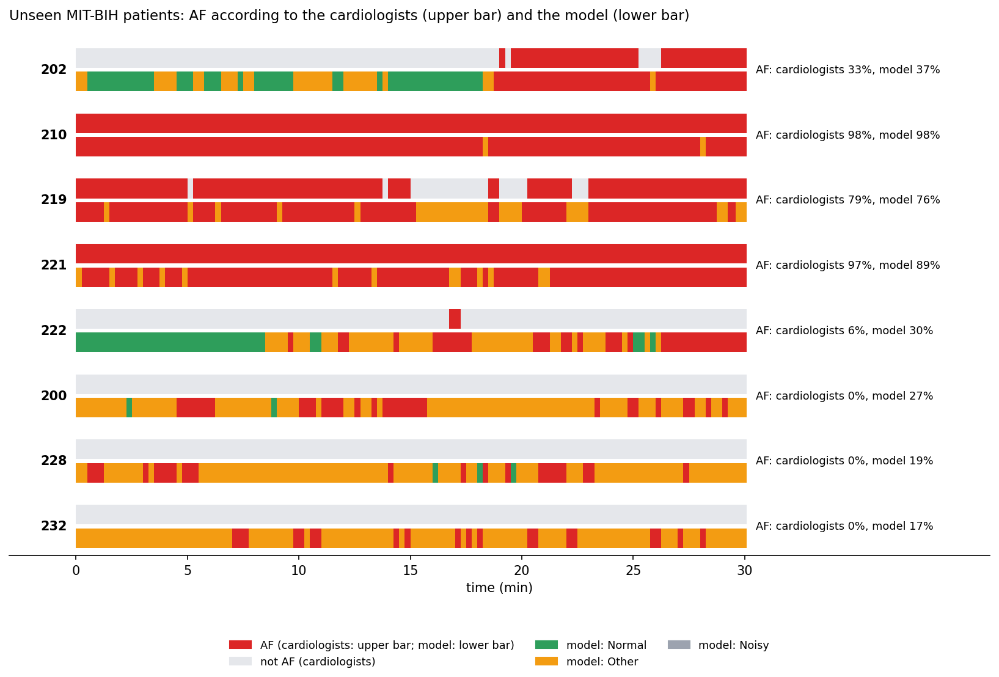
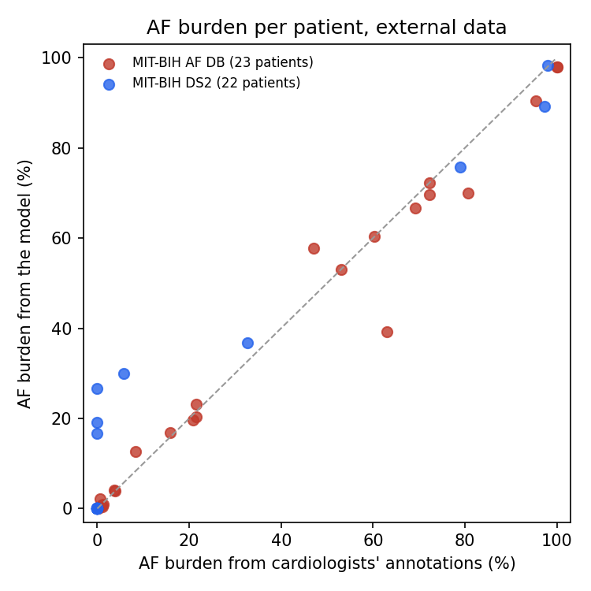

# ECG AF Detector

Finds atrial fibrillation (AF) in a single-lead ECG. Every 30 seconds of the recording is classified as normal rhythm,
AF, another abnormal rhythm, or too noisy to read, and the app reports how much of the time was spent in AF (the AF
burden). Trained on short recordings from a handheld device; tested on a locked test set and on long Holter
recordings from 45 patients the model never saw.

[](https://colab.research.google.com/github/fady-mostafa-omar/ecg-af-detector/blob/main/notebooks/ecg_af_detector.ipynb)
[](https://github.com/fady-mostafa-omar/ecg-af-detector/actions/workflows/ci.yml)

| Basic: for anyone | Advanced: for clinicians and researchers |
|---|---|
|  |  |

## The app

Pick a bundled example or upload your own single-lead ECG (CSV, any sampling rate of at least 100 Hz, 9 s to 4 h).

- **Basic:** recording length, average heart rate, share of time in AF, number of AF episodes and the longest one,
  signal quality, a colored rhythm timeline, and the ECG on standard paper (it opens at the first AF episode).
- **Advanced:** the model's timeline next to the cardiologists' (for the examples), the probability of each rhythm
  over time, the ECG with every beat colored by its window's rhythm (hover for the probabilities), a "next AF episode"
  button, beat-to-beat (RR) interval and Poincaré plots, agreement with the cardiologists, and a window-by-window CSV.
- **How it works:** method, test results and limitations.
- **Examples (none used for training):** MIT-BIH 202 · 30 min · paroxysmal AF (episodes); MIT-BIH 210 · 30 min · AF throughout; MIT-BIH 100 · 30 min · normal rhythm; MIT-BIH 200 · 30 min · many extra beats, no AF (a known false-alarm case); AF Database 04043 · 1-h excerpt from 5:35 · AF episodes; CinC 2017 test A00002 · 30 s · expert label: Normal rhythm; CinC 2017 test A00067 · 30 s · expert label: Atrial fibrillation; CinC 2017 test A00013 · 30 s · expert label: Other abnormal rhythm; CinC 2017 test A00022 · 30 s · expert label: Too noisy.

**Try it:** open the [Colab notebook](https://colab.research.google.com/github/fady-mostafa-omar/ecg-af-detector/blob/main/notebooks/ecg_af_detector.ipynb) and run sections 0 and 1. It prints a temporary public link to the
app, which stays active while that cell runs. If the link cannot be created (Gradio's link service is sometimes down), run the notebook's next cell instead: it opens the app through Colab.

## Problem

Atrial fibrillation is the most common sustained heart-rhythm disorder, and it raises the risk of stroke about
fivefold (Wolf et al., 1991). It often comes and goes (paroxysmal AF) and can cause no symptoms, so a short ECG in the
clinic easily misses it. Handheld and wearable devices can record a single-lead ECG anywhere, but their recordings are
short and noisy, and many other rhythms are irregular too. The PhysioNet/Computing in Cardiology Challenge 2017 asked
for exactly this: sort short single-lead recordings into normal rhythm, AF, other rhythm or too noisy
(Clifford et al., 2017). This project builds an open, CPU-friendly classifier for that task, tests it on a test set
locked before any model was built, and then checks whether it can also track AF episodes and the AF burden in long
Holter recordings from other patients and devices.

## Data

| Dataset | Used for | Content |
|---|---|---|
| [PhysioNet/CinC Challenge 2017](https://physionet.org/content/challenge-2017/1.0.0/) | training, locked test | 8,528 recordings, 9–61 s, 300 Hz, AliveCor handheld device (lead I-like) |
| [MIT-BIH Arrhythmia Database](https://physionet.org/content/mitdb/1.0.0/), DS2 | external test | 22 patients, 30 min each, 360 Hz, lead MLII (lead II-like); AF in records 202, 210, 219, 221, 222 (94 min) |
| [MIT-BIH Atrial Fibrillation Database](https://physionet.org/content/afdb/1.0.0/) | external test | 23 patients with signals, about 10 h each (234 h), 250 Hz, first ECG channel; 93 h of AF |

All three are on PhysioNet under the Open Data Commons Attribution License v1.0. They are not stored in this
repository; `scripts/download_data.sh` downloads them.

- CinC 2017 labels: the organizers revised them several times; the final version (v3) is used:
  Normal 5,076 · AF 758 · Other 2,415 · Noisy 279. The labels describe the whole recording.
- The Challenge's own test set is hidden. Its public "validation" folder is a subset of the training set, so it is not
  an independent test.
- **Locked split:** a stratified 20% of the recordings was set aside as the test set before any model was built
  ([`splits/cinc2017_split.csv`](splits/cinc2017_split.csv)). Recordings with identical samples (exact duplicates)
  were kept on the same side.
- MIT-BIH DS2 is the test half of the inter-patient split (de Chazal et al., 2004) used in
  [ecg-arrhythmia-detector](https://github.com/fady-mostafa-omar/ecg-arrhythmia-detector). Neither MIT-BIH database was used for training or model selection.

| Part | Normal | AF | Other | Noisy | Total |
|---|---|---|---|---|---|
| Training part (5 folds, model selection) | 4,061 | 606 | 1,932 | 223 | 6,822 |
| Locked test set | 1,015 | 152 | 483 | 56 | 1,706 |

## Method



- **R-peak detection:** WFDB's XQRS detector; each peak is then moved to the largest absolute amplitude within
  ±100 ms, so either signal polarity works (reused from [ecg-arrhythmia-detector](https://github.com/fady-mostafa-omar/ecg-arrhythmia-detector)).
- **35 features per window:** 21 beat-timing features (heart rate, variability, share of irregular intervals,
  Poincaré SD1/SD2, turning-point ratio, RR-histogram entropy, sample entropy and COSEn: the core signature of AF is
  irregularly irregular timing), 8 features of the average beat (template correlation, R amplitude, QRS width, P-wave
  and T-wave size: AF has no P waves), and 6 signal-quality features.
- **Network:** a residual 1D-CNN (stride-2 stem and 6 residual blocks, 32 to 128 channels, mean and max pooling)
  on the window, fused with the standardized features; 820,516 parameters.
- **Training (training part only):** folds 1–4 train the network; fold 0 chooses the epoch with the best mean F1 of
  all four classes (Noisy included, although the official score leaves it out). Class-weighted cross-entropy
  (1/√class count), AdamW with a one-cycle learning rate, 30 epochs, polarity, amplitude and noise augmentation.
- **Shipped model:** the average of 5 networks trained with different random seeds
  (4,102,580 parameters). This choice was fixed before the ensemble was evaluated.
- **Recording class:** the average of its windows' probabilities. Long recordings get one class per window.
- **Baseline:** gradient boosting (scikit-learn) on the same 35 features computed over the whole recording.

## Results

### Locked test set (1,706 CinC 2017 recordings, scored once)

Official Challenge score = mean F1 of Normal, AF and Other (F1 Noisy is shown but not averaged). Labeling every
recording "Normal" would score 0.249.

| Model | Official score | F1 Normal | F1 AF | F1 Other | F1 Noisy |
|---|---|---|---|---|---|
| Gradient boosting | 0.812 | 0.899 | 0.817 | 0.720 | 0.693 |
| CNN, single (mean ± SD, 5 seeds) | 0.815 ± 0.006 | 0.896 ± 0.006 | 0.816 ± 0.013 | 0.734 ± 0.007 | 0.648 ± 0.028 |
| **CNN, 5-seed ensemble (shipped)** | 0.825 | 0.905 | 0.818 | 0.753 | 0.685 |

- **Ensemble vs gradient boosting:** difference +0.014 (95% paired bootstrap interval -0.009 to +0.037,
  2,000 resamples of the test recordings): the interval includes zero, so on this test set the two are **not clearly different**.
- **AF recordings:** the ensemble finds 128 of 152
  (sensitivity 84.2%); 79.5% of its AF calls are correct; specificity
  97.9% (non-AF recordings not called AF). Gradient boosting: 118 of
  152 (77.6%); 86.1% correct; specificity
  98.8%.



Baseline feature set, chosen by 5-fold cross-validation on the training part (mean ± SD over folds):

| Gradient boosting | CV score | F1 Normal | F1 AF | F1 Other | F1 Noisy |
|---|---|---|---|---|---|
| RR features only | 0.768 ± 0.021 | 0.882 | 0.743 | 0.680 | 0.485 |
| All features ← chosen | 0.813 ± 0.013 | 0.901 | 0.799 | 0.739 | 0.634 |
| All features, class-balanced | 0.809 ± 0.012 | 0.895 | 0.802 | 0.730 | 0.629 |

Re-running `scripts/baseline.py` in a later Colab session gave CV scores within 0.003 of these, picked "All features, class-balanced", and scored 0.814 on the test set (files in `results/history/`). The shipped baseline is the original run above.

### External test: long Holter recordings from other patients and devices



*Upper bar: cardiologists; lower bar: the model, window by window. Shown: the unseen MIT-BIH patients with AF, and those without AF for whom the model reported AF more than 10% of the time.*

Rules fixed before looking at the results: every 30-s window (15-s step) is compared with the cardiologists' rhythm
annotations; a window is AF if more than half of it is annotated AF; atrial flutter and all other rhythms count as
not AF; a window the model calls Noisy counts as not AF.

| Database | Model | Windows | AF windows | AF sensitivity % | AF positive predictivity % | Specificity % | F1 % |
|---|---|---|---|---|---|---|---|
| MIT-BIH DS2 | CNN ensemble | 2,640 | 377 | 93.9 | 75.2 | 94.8 | 83.5 |
| MIT-BIH DS2 | Gradient boosting | 2,640 | 377 | 98.1 | 73.9 | 94.2 | 84.3 |
| MIT-BIH AF DB | CNN ensemble | 56,207 | 22,402 | 93.7 | 97.2 | 98.2 | 95.4 |
| MIT-BIH AF DB | Gradient boosting | 56,207 | 22,402 | 90.2 | 97.9 | 98.7 | 93.9 |

AF burden (share of time in AF) per patient, model vs cardiologists:

| Database | Model | Patients | Mean absolute error (percentage points) | Correlation r |
|---|---|---|---|---|
| MIT-BIH DS2 | CNN ensemble | 22 | 4.7 | 0.96 |
| MIT-BIH DS2 | Gradient boosting | 22 | 4.9 | 0.94 |
| MIT-BIH AF DB | CNN ensemble | 23 | 3.1 | 0.99 |
| MIT-BIH AF DB | Gradient boosting | 23 | 4.1 | 0.98 |



- On the AF Database (long recordings with a lot of AF), the ensemble finds 93.7% of the AF windows,
  and 97.2% of its AF windows are AF.
- On MIT-BIH DS2, it finds 93.9% of the AF windows, but only 75.2% of its AF windows
  are AF. 64% of its 117 false AF windows come from 3 patients without
  AF but with many extra beats (records 200, 228, 232; see Limitations).

### Size and speed

5 × 820,516 parameters (16.7 MB). On a Google Colab
CPU (2 threads), the ensemble needs 16 ms per 30-s
window, and 30 minutes of ECG is analyzed end to end (R peaks, features, 5 networks) in
6 s.

### Reported in the literature

Not reproduced here. The Challenge's hidden test set (3,658 recordings) is not public. Four teams tied for first
place with an overall score of 0.83 on it (Datta et al., Hong et al., Teijeiro et al., Zabihi et al.; see
Clifford et al., 2017). The 0.825 above is on a locked 20% split of the public training data, so the two numbers
are not directly comparable.

## Limitations

- **Frequent extra beats can look like AF.** In MIT-BIH records with no AF annotated, the model reported AF for
  part of the time: 200 (27% of the time; 33% of its beats are extra beats), 228 (19% of the time; 18% of its beats are extra beats), 232 (17% of the time; 78% of its beats are extra beats). Extra (ectopic) beats make the timing irregular, which mimics AF.
  AF is also over-called in record 222: cardiologists 6%, model 30% (this record also contains atrial flutter).
  A planned follow-up combines this model with the heartbeat classifier of [ecg-arrhythmia-detector](https://github.com/fady-mostafa-omar/ecg-arrhythmia-detector) to tell
  extra beats from AF.
- Atrial flutter counts as "not AF" in the external tests; the model may call it AF or Other.
- CinC 2017 has no patient identifiers, so the internal split cannot guarantee that no person appears in both parts.
  The external tests do not have this problem.
- The CinC labels were revised several times by the organizers, so some are uncertain.
- The ensemble's gain over gradient boosting on the locked test set is small and not statistically clear.
- Retraining is not bit-for-bit reproducible across environments (GPU for the CNN; software version or CPU for
  gradient boosting); the shipped models are the ones evaluated here.
- Not tested on AD8232 or other do-it-yourself boards; a lead II-like electrode placement is expected to work best.
- Research and education tool, not a medical device.

## How to run

**Google Colab:** open the notebook with the badge above. Section 0 installs everything, section 1 starts the app
(no download needed), and section 2 reproduces every result.

**Local:**

```bash
git clone https://github.com/fady-mostafa-omar/ecg-af-detector.git
cd ecg-af-detector
pip install -r requirements.txt
python app/app.py                    # app at http://127.0.0.1:7860 (bundled examples)
bash scripts/download_data.sh        # CinC 2017, MIT-BIH Arrhythmia DB, MIT-BIH AF DB
python scripts/build_dataset.py      # data/cinc2017.npz; checks the locked split
python scripts/extract_features.py   # R peaks, features, 30-s windows (all CPU cores)
python scripts/baseline.py           # gradient boosting: 5-fold CV, then the test set
python scripts/train_cnn.py          # optional: retrain the 5-seed ensemble (GPU recommended)
python scripts/evaluate.py           # locked test set -> results/
python scripts/external_test.py      # MIT-BIH DS2 and AF Database -> results/
python -m pytest -q                  # unit tests
```

All parameters are in `configs/default.yaml`.

```
configs/default.yaml        all parameters
splits/cinc2017_split.csv   the locked train/test split and the 5 folds
src/afsuite/                R-peak detection, features, CNN, scoring, external-test helpers
scripts/                    download, build dataset, features, baseline, train, evaluate, external test
app/app.py                  Gradio app (Basic, Advanced, How it works) + app/examples/examples.npz
models/                     shipped CNN ensemble and gradient-boosting baseline
results/                    tables and figures written by the scripts
notebooks/                  Colab notebook
tests/                      unit tests, run by CI on every push
```

## About this project

A new project (2026), built on public data only. Its R-peak detector comes from [ecg-arrhythmia-detector](https://github.com/fady-mostafa-omar/ecg-arrhythmia-detector).

## Citations

- G. D. Clifford, C. Liu, B. Moody, L. H. Lehman, I. Silva, Q. Li, A. E. Johnson, and R. G. Mark, "AF classification
  from a short single lead ECG recording: the PhysioNet/Computing in Cardiology Challenge 2017," *Computing in
  Cardiology*, vol. 44, 2017, doi:10.22489/CinC.2017.065-469.
- G. B. Moody and R. G. Mark, "A new method for detecting atrial fibrillation using R-R intervals," *Computers in
  Cardiology*, vol. 10, pp. 227–230, 1983 (MIT-BIH Atrial Fibrillation Database).
- G. B. Moody and R. G. Mark, "The impact of the MIT-BIH Arrhythmia Database," *IEEE Eng. Med. Biol. Mag.*, vol. 20,
  no. 3, pp. 45–50, 2001.
- A. L. Goldberger et al., "PhysioBank, PhysioToolkit, and PhysioNet," *Circulation*, vol. 101, no. 23,
  pp. e215–e220, 2000.
- P. de Chazal, M. O'Dwyer, and R. B. Reilly, "Automatic classification of heartbeats using ECG morphology and
  heartbeat interval features," *IEEE Trans. Biomed. Eng.*, vol. 51, no. 7, pp. 1196–1206, 2004.
- J. S. Richman and J. R. Moorman, "Physiological time-series analysis using approximate entropy and sample entropy,"
  *Am. J. Physiol. Heart Circ. Physiol.*, vol. 278, no. 6, pp. H2039–H2049, 2000.
- D. E. Lake and J. R. Moorman, "Accurate estimation of entropy in very short physiological time series: the problem
  of atrial fibrillation detection in implanted ventricular devices," *Am. J. Physiol. Heart Circ. Physiol.*,
  vol. 300, no. 1, pp. H319–H325, 2011.
- K. He, X. Zhang, S. Ren, and J. Sun, "Deep residual learning for image recognition," *Proc. CVPR*, 2016.
- P. A. Wolf, R. D. Abbott, and W. B. Kannel, "Atrial fibrillation as an independent risk factor for stroke: the
  Framingham Study," *Stroke*, vol. 22, no. 8, pp. 983–988, 1991.
- WFDB Software Package for Python: https://github.com/MIT-LCP/wfdb-python

## License

Code: MIT. Data: PhysioNet/CinC Challenge 2017, MIT-BIH Arrhythmia Database and MIT-BIH Atrial Fibrillation Database,
Open Data Commons Attribution License v1.0. Only the short excerpts in `app/examples/examples.npz` are redistributed
here, under the same license.
